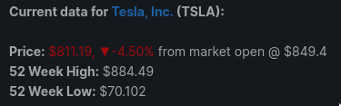

## deprecation notice
the rapidapi endpoint that this plugin uses has had background changes that have made it complicated for new users to configure.

a new version of this plugin has been created at [maubot-financebot](https://github.com/williamkray/maubot-financebot) that uses
the Alpha Vantage API, which is free for low-volume usage and provides easier access and better documentation.

this is still functional but will no longer be updated or maintained.

## tickerbot

a simple maubot module that responds with financial data about stock price or cryptocurrency exchange rate.

To install, please see the [standard maubot plugin installation instructions](https://github.com/maubot/maubot/wiki/Usage#adding-a-plugin)

note: this module depends on having an api key for the following services

- [RapidAPI](https://rapidapi.com/marketplace) (used for the [yahoo-finance api endpoints](https://rapidapi.com/apidojo/api/yh-finance/), which you must subscribe to in your account settings)
- [CoinAPI](https://www.coinapi.io/Pricing)

## Setup
plug in API keys for both your RapidAPI yahoo finance app and your CoinAPI account in the config file (either before packaging in the base-config, or directly in the maubot interface after loading).

when using rapidAPI for yahoo finance, the endpoints changed. currently, the default endpoint is
`yh-finance.p.rapidapi.com`. However, if this gives you trouble, it may be because you created your "application" in
RapidAPI before the change. Try setting the rapidapiHost value in your config to
`apidojo-yahoo-finance-v1.p.rapidapi.com`. Most new installs will not need to mess with this.

update the commands you want to use, by default stock data is returned with the `!stonks` command, and crypto data is returned with `!hodl` command. for example:

`!stonks tsla`

would return something like this:

and

`!hodl btc/ada`

would return something like this:

